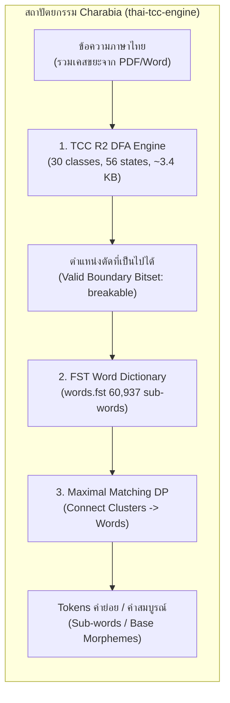
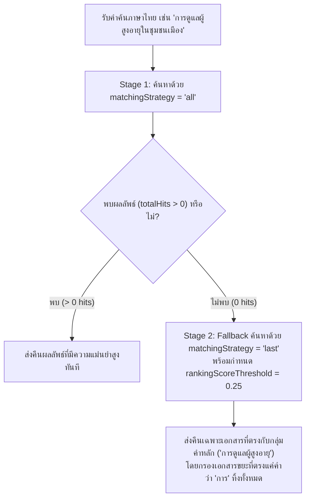

# แนวทางปฏิบัติที่ดีที่สุดสำหรับการค้นหาภาษาไทยด้วย Meilisearch + Charabia (Meilisearch Thai Best Practices)

คลังเก็บโค้ด (Repository) นี้รวบรวมแนวทางปฏิบัติที่ดีที่สุด (Best Practices) สำหรับการนำ **Meilisearch** ร่วมกับตัวตัดคำภาษาไทยรุ่นปรับปรุงพิเศษ **[`kamthorn/charabia` (`thai-tcc-engine`)](https://github.com/kamthorn/charabia/tree/thai-tcc-engine)** ไปใช้งานจริงในระดับ Production โดยถอดบทเรียนจากการพัฒนาเครื่องยนต์ตัดคำภาษาไทยด้วยสถาปัตยกรรมสองชั้น (TCC R2 DFA Pre-segmenter + Sub-word Dictionary DP) ใน Charabia และการนำไปใช้งานจริงบนระบบฐานข้อมูลวารสารวิชาการอิเล็กทรอนิกส์แห่งประเทศไทย (**ThaiJO — Thai Journals Online**) ที่รองรับบทความวิชาการและเอกสารวิจัยภาษาไทย-อังกฤษจำนวนมาก

---

## สารบัญ

1. [ทำไม Meilisearch มาตรฐานถึงมีปัญหากับภาษาไทยในงานจริง?](#1-ทำไม-meilisearch-มาตรฐานถึงมีปัญหากับภาษาไทยในงานจริง)
2. [โครงสร้างโปรเจกต์ (Repository Structure)](#2-โครงสร้างโปรเจกต์-repository-structure)
3. [การเริ่มต้นใช้งานอย่างรวดเร็ว (Quick Start)](#3-การเริ่มต้นใช้งานอย่างรวดเร็ว-quick-start)
   - [3.1 ใช้งานผ่าน Docker Hub (`kamthorn/meilisearch`)](#31-ใช้งานผ่าน-docker-hub-kamthornmeilisearch)
   - [3.2 การ Build Docker Image ด้วยตนเอง (`[patch.crates-io]`)](#32-การ-build-docker-image-ด้วยตนเอง-patchcrates-io)
4. [เจาะลึกสถาปัตยกรรม Tokenizer & Normalizer ใน `thai-tcc-engine`](#4-เจาะลึกสถาปัตยกรรม-tokenizer--normalizer-ใน-thai-tcc-engine)
   - [4.1 สถาปัตยกรรมสองชั้น: TCC R2 DFA Pre-segmenter + Maximal Matching DP](#41-สถาปัตยกรรมสองชั้น-tcc-r2-dfa-pre-segmenter--maximal-matching-dp)
   - [4.2 ปรัชญาพจนานุกรมแบบ Sub-word / Base Morpheme (60,937 คำ)](#42-ปรัชญาพจนานุกรมแบบ-sub-word--base-morpheme-60937-คำ)
   - [4.3 การทำความสะอาดอักขระขยะจากไฟล์ PDF / MS Word / OJS](#43-การทำความสะอาดอักขระขยะจากไฟล์-pdf--ms-word--ojs)
5. [การตั้งค่า Index Settings ระดับ Production (ถอดบทเรียนจาก ThaiJO)](#5-การตั้งค่า-index-settings-ระดับ-production-ถอดบทเรียนจาก-thaijo)
   - [5.1 ลำดับ `rankingRules`: ย้าย `exactness` ขึ้นก่อน `typo`](#51-ลำดับ-rankingrules-ย้าย-exactness-ขึ้นก่อน-typo)
   - [5.2 `proximityPrecision: "byWord"` คู่หูของการตัดคำแบบ Sub-word](#52-proximityprecision-byword-คู่หูของการตัดคำแบบ-sub-word)
   - [5.3 การควบคุม `typoTolerance` ไม่ให้เพี้ยนบนคำไทยสั้น ๆ](#53-การควบคุม-typotolerance-ไม่ให้เพี้ยนบนคำไทยสั้น-ๆ)
   - [5.4 การบังคับตัวตัดคำด้วย `localizedAttributes`](#54-การบังคับตัวตัดคำด้วย-localizedattributes)
   - [5.5 Curated Stop Words และ Bilingual Synonyms](#55-curated-stop-words-และ-bilingual-synonyms)
   - [5.6 Granular `filterableAttributes` ประหยัด RAM ตอน Index](#56-granular-filterableattributes-ประหยัด-ram-ตอน-index)
6. [รูปแบบการคิวรีและการดูแลระบบระดับ Production](#6-รูปแบบการคิวรีและการดูแลระบบระดับ-production)
   - [6.1 Two-Stage Matching Strategy (`ALL` $\rightarrow$ `LAST` + `rankingScoreThreshold`)](#61-two-stage-matching-strategy-all--last--rankingscorethreshold)
   - [6.2 Zero-Downtime Reindexing ด้วย Atomic Index Swapping](#62-zero-downtime-reindexing-ด้วย-atomic-index-swapping)
   - [6.3 Hybrid Search (Keyword + Multilingual Vector Embedding)](#63-hybrid-search-keyword--multilingual-vector-embedding)
   - [6.4 การตั้งค่า Infrastructure (`ulimits`, `searchCutoffMs`, Batching)](#64-การตั้งค่า-infrastructure-ulimits-searchcutoffms-batching)
7. [เปรียบเทียบ Meilisearch (`thai-tcc-engine`) vs รุ่นมาตรฐาน](#7-เปรียบเทียบ-meilisearch-thai-tcc-engine-vs-รุ่นมาตรฐาน)
8. [ผลการรันชุดทดสอบอัตโนมัติ (Verification Output)](#8-ผลการรันชุดทดสอบอัตโนมัติ-verification-output)

---

## 1. ทำไม Meilisearch มาตรฐานถึงมีปัญหากับภาษาไทยในงานจริง?

แม้ Meilisearch จะมีไลบรารี `charabia` สำหรับตัดคำหลายภาษา แต่เมื่อนำไปใช้กับข้อมูลภาษาไทยในโลกจริง (เช่น บทความวิชาการในระบบ OJS / ThaiJO, เอกสารราชการ, หรือข้อมูลสินค้าที่คัดลอกมาจากไฟล์ PDF และ MS Word) มักพบปัญหาสำคัญ 5 ประการ:

1. **คำประสมวิชาการถูกมัดรวมเป็นก้อนเดียว (Over-compounding):** พจนานุกรมแบบ NLP มักเก็บคำประสมยาว ๆ เช่น `ปัญญาประดิษฐ์`, `เคมีบำบัด`, `จุลชีววิทยา`, `วิศวกรรมซอฟต์แวร์` เป็น 1 โทเคน ส่งผลให้เมื่อผู้ใช้ค้นหาคำย่อยตัวหลัง เช่น `"ประดิษฐ์"`, `"บำบัด"`, หรือ `"ชีววิทยา"` ระบบจะค้นไม่เจอเลย (Zero Recall) เพราะ Meilisearch ทำแต่ Prefix Search ไม่ทำ Suffix/Infix Search
2. **อักขระ Zero-Width (`U+200B`, `U+200C`, `U+FEFF`) ทำให้คำขาดกลาง:** ผู้แต่งบทความจำนวนมากคัดลอกข้อความจาก MS Word หรือ PDF ซึ่งแทรก `U+200B` (ZWSP) ไว้ตามพยางค์เพื่อตัดบรรทัด เช่น `"ประ\u{200b}ดิษฐ์"` หรือมี `U+FEFF` (BOM) ติดมา ใน Charabia มาตรฐาน อักขระเหล่านี้ถูกจัดเป็น Separator (หรือในกรณีของ `U+FEFF` ถูกจัดหมวดผิดเป็นอักษรอาหรับ `Script::Arabic`) ทำให้คำว่า `"ประดิษฐ์"` ถูกหั่นออกเป็น `["ประ", "ดิษฐ์"]` ทันทีก่อนเข้าตัวตัดคำ ส่งผลให้ค้นคำว่า `"ประดิษฐ์"` ไม่เจอ
3. **สระอำแยกส่วนจาก PDF / OJS (`นํ้า` vs `น้ำ`):** เอกสารจาก PDF/macOS/OJS มักเข้ารหัสคำว่า `"น้ำ"` เป็น `น` + นิคหิต (`U+0E4D`) + ไม้โท (`U+0E49`) + สระอา (`U+0E32`) แทนที่จะเป็น `น` + ไม้โท (`U+0E49`) + สระอำ (`U+0E33`) ทำให้ทั้งขั้นตอนตัดคำและขั้นตอนจับคู่คำค้นล้มเหลว
4. **วรรณยุกต์หรือสระลอยซ้ำซ้อน (`้้`, `ิิ`):** การพิมพ์ไม้โทหรือสระอิซ้ำ 2 ตัวซ้อนกัน (เช่น `"ข้้้อความ"`, `"วิิเคราะห์"`) มองด้วยตาเปล่าบนเว็บไม่เห็นความต่าง แต่รหัส Unicode ไม่ตรงกับคำค้นปกติ
5. **ค่าเริ่มต้นของ Typo Tolerance และ Matching Strategy ใน Meilisearch ไม่เหมาะกับคำไทย:**
   - คำมูลภาษาไทยสั้นมาก (3–5 ตัวอักษร) การยอมให้พิมพ์ผิด 1 ตัวอักษรตั้งแต่คำความยาว 5 ตัว (`oneTypo: 5`) ทำให้คำคนละความหมายอย่าง `"กล้อง"` กับ `"กลอง"` หรือ `"เสื้อ"` กับ `"เสือ"` ปะปนกันมั่ว
   - `matchingStrategy: "last"` (ค่าเริ่มต้นของ Meilisearch) เมื่อเจอคำค้นภาษาไทยยาว ๆ เช่น `"การพยาบาลผู้สูงอายุในชุมชน"` ที่ไม่มีเอกสารใดมีครบทุกคำ ระบบจะค่อย ๆ ตัดคำท้ายทิ้งจนเหลือแค่คำว่า `"การ"` คำเดียว แล้วคืนเอกสารที่ไม่เกี่ยวข้องออกมาเป็นแสนรายการ

---

## 2. โครงสร้างโปรเจกต์ (Repository Structure)

```text
meilisearch-thai-best-practices/
├── docker-compose.yml                                 # Docker Compose พร้อมรัน kamthorn/meilisearch:v1.56.0
├── docker/
│   ├── Dockerfile                                     # Multi-stage Dockerfile สำหรับ patch kamthorn/charabia@thai-tcc-engine
│   └── build-multiarch.sh                             # สคริปต์ build และ push multi-arch (amd64 + arm64)
├── 01-index-settings/
│   ├── 01-curated-stopwords.json                      # รายการ Stop words ภาษาไทยที่ปลอดภัย (ไม่ทำ Over-filtering)
│   ├── 02-synonyms.json                               # รายการคำพ้องความหมาย ไทย-อังกฤษ-คำย่อ
│   ├── 03-typo-tolerance.json                         # การตั้งค่า Typo Tolerance ป้องกันคำไทยสั้นเพี้ยน
│   ├── 04-full-thai-settings.json                     # การตั้งค่า Index Settings ภาษาไทยฉบับสมบูรณ์
│   └── 05-thaijo-articles-settings.json               # การตั้งค่าจริงจากระบบ Production ของ ThaiJO (Nested Locales)
├── 02-search-patterns/
│   ├── 01-matching-strategy-and-fallback.json         # รูปแบบคิวรี 2 ขั้นตอน (ALL -> LAST + rankingScoreThreshold)
│   ├── 02-zero-downtime-swap.json                     # การ Reindex แบบ Zero-downtime ด้วย /swap-indexes
│   └── 03-hybrid-search.json                          # การตั้งค่า Hybrid Search (Keyword + Multilingual Vector)
└── sample-data/
    ├── articles.json                                  # ข้อมูลบทความจำลอง 12 รายการที่รวมเคสปัญหาภาษาไทยครบถ้วน
    └── test-meilisearch-thai.sh                       # สคริปต์ทดสอบอัตโนมัติ 21 การทดสอบ (End-to-End Verification)
```

---

## 3. การเริ่มต้นใช้งานอย่างรวดเร็ว (Quick Start)

### 3.1 ใช้งานผ่าน Docker Hub (`kamthorn/meilisearch`)

เราได้คอมไพล์อิมเมจ Meilisearch ที่รวมแพตช์ `kamthorn/charabia` (`branch = "thai-tcc-engine"`) แบบ Multi-architecture (`linux/amd64` และ `linux/arm64`) ไว้บน Docker Hub เรียบร้อยแล้วที่ **`kamthorn/meilisearch:v1.56.0`** (และ `:latest`):

```bash
# 1. รัน Meilisearch ผ่าน Docker Compose
docker compose up -d

# 2. รันชุดทดสอบอัตโนมัติ (ตั้งค่า Index + นำเข้าข้อมูล + ตรวจสอบ 21 เคสภาษาไทย)
./sample-data/test-meilisearch-thai.sh
```

### 3.2 การ Build Docker Image ด้วยตนเอง (`[patch.crates-io]`)

หากต้องการคอมไพล์ Meilisearch จากซอร์สโค้ดด้วยตนเอง หรือต้องการอัปเกรดเวอร์ชัน Meilisearch ในอนาคต สามารถใช้ [docker/Dockerfile](docker/Dockerfile) ซึ่งใช้กลไก `[patch.crates-io]` ของ Cargo เพื่อแทนที่ `charabia` ต้นฉบับด้วย `kamthorn/charabia`:

```toml
# ส่วนที่ถูกเติมลงใน Cargo.toml ของ Meilisearch อัตโนมัติขณะ Build
[patch.crates-io]
charabia = { git = "https://github.com/kamthorn/charabia.git", branch = "thai-tcc-engine" }
```

คำสั่งสำหรับ Build อิมเมจ:

```bash
# Build สำหรับเครื่องปัจจุบัน
docker build -t my-meilisearch:v1.56.0 ./docker

# หรือ Build แบบ Multi-arch (amd64 + arm64) และ Push ขึ้น Registry
IMAGE_REPO=docker.io/kamthorn/meilisearch TAG=v1.56.0 ./docker/build-multiarch.sh
```

---

## 4. เจาะลึกสถาปัตยกรรม Tokenizer & Normalizer ใน `thai-tcc-engine`

### 4.1 สถาปัตยกรรมสองชั้น: TCC R2 DFA Pre-segmenter + Maximal Matching DP

การตัดคำภาษาไทยที่ถูกต้องสำหรับ Search Engine ไม่ควรใช้กฎตัดคำหรือพจนานุกรมเดี่ยว ๆ แต่ต้องผสานกันเป็น 2 ชั้นอย่างลงตัว:



1. **ระดับกลุ่มอักขระย่อย (Thai Character Cluster — TCC R2 DFA):**
   - นำเครื่องยนต์ **TCC R2 DFA** จากโครงการ [`thai-tcc`](https://github.com/kamthorn/thai-tcc) เข้ามาแทนที่ฟังก์ชัน `is_breakable` เดิมของ Charabia
   - ประกอบด้วยกฎสัทศาสตร์ภาษาไทย 30 ข้อทั่วไป + 2 ข้อ lookahead คอมไพล์เป็น DFA และลดรูปด้วย Moore Partition Refinement เหลือ **56 สถานะ** (ใช้หน่วยความจำเพียง **~3.4 KB**)
   - ทำหน้าที่เป็น **Pre-segmenter** ที่ปลอดภัยและรวดเร็วระดับ $O(N)$ (~10.2 ns/char) คัดกรองจุดตัดที่เป็นไปไม่ได้ทิ้งไปล่วงหน้าถึง **~50%** (ล็อกสระบน/ล่าง วรรณยุกต์ ตัวการันต์ อักษรควบหน้าสระเอ เช่น `เพลิง`, `เครื่อง` ไม่ให้ฉีกขาด)
   - ช่วยลดพื้นที่การค้นหาของ Dynamic Programming ใน FST ลง ทำให้ตัดคำเร็วขึ้น **~3.2%**
2. **ระดับพจนานุกรม (Maximal Matching via Dynamic Programming):**
   - ตัวค้นหาพจนานุกรม (`words.fst` ขนาด 852 KB) จะวิ่งเชื่อมต่อ (compose) กลุ่ม TCC ย่อย ๆ เข้าด้วยกันจนกลายเป็นคำที่สมบูรณ์ โดยรับประกันว่าขอบเขตของคำจะตกตรงรอยต่อของ TCC เสมอ (`breakable[start + len] == true`)

### 4.2 ปรัชญาพจนานุกรมแบบ Sub-word / Base Morpheme (60,937 คำ)

พจนานุกรมสำหรับ **Search Engine** ต้องออกแบบต่างจากพจนานุกรมสำหรับงานแปลภาษา (MT/NLP):

| ประเภทคำ | แนวทางใน `thai-tcc-engine` | ตัวอย่างการตัดคำ | เหตุผลทางด้าน Search Relevance |
| :--- | :--- | :--- | :--- |
| **คำประสมวิชาการ / คำสมาสยาว** | **แยกเป็นคำย่อย (Split)** (คัดออก 157 คำประสมยาวและชื่อหน่วยงาน) | `ปัญญาประดิษฐ์` $\rightarrow$ `["ปัญญา", "ประดิษฐ์"]`<br>`เคมีบำบัด` $\rightarrow$ `["เคมี", "บำบัด"]`<br>`จุลชีววิทยา` $\rightarrow$ `["จุล", "ชีว", "วิทยา"]`<br>`วิศวกรรมซอฟต์แวร์` $\rightarrow$ `["วิศวกรรม", "ซอฟต์แวร์"]` | เพื่อให้ผู้ใช้ที่ค้นหาคำย่อยตัวหลัง เช่น `"ประดิษฐ์"`, `"บำบัด"`, `"ชีววิทยา"`, `"ซอฟต์แวร์"` สามารถค้นเจอบทความได้เสมอ |
| **คำมูล 2 พยางค์ที่แยกแล้วความหมายเปลี่ยน** | **ห้ามแยก (Preserve as 1 Token)** | `ดูแล` $\rightarrow$ `["ดูแล"]`<br>`ทำงาน` $\rightarrow$ `["ทำงาน"]`<br>`น่ารัก` $\rightarrow$ `["น่ารัก"]`<br>`เข้าใจ` $\rightarrow$ `["เข้าใจ"]` | หากแยก `"ดูแล"` เป็น `"ดู"` + `"แล"` เมื่อเจอประโยค `"คนดีดูแลสุขภาพ"` จะเกิดลำดับโทเคน `["คน", "ดี", "ดู", "แล"]` ทำให้คนค้นคำว่า `"ดีดู"` จับคู่ข้ามขอบคำผิดพลาด (False Positive) |

### 4.3 การทำความสะอาดอักขระขยะจากไฟล์ PDF / MS Word / OJS

ใน `kamthorn/charabia` (`thai-tcc-engine`) การทำ Normalization ทำงานสอดประสานกันตั้งแต่ **ก่อนตัดคำ (Pre-segmentation)**, **ขณะวิ่งหาคำใน FST (`ThaiSegmenter`)**, จนถึง **การปรับรูปโทเคน (`ThaiNormalizer`)** พร้อมรักษา `char_map` สำหรับทำ Highlighting:

1. **การประกอบร่างสระอำ (Decomposed Sara Am Recomposition):**
   - แปลง `นิคหิต (U+0E4D) + วรรณยุกต์ (U+0E48..U+0E4B) + สระอา (U+0E32)` (เช่น `นํ้า` จากไฟล์ PDF/OJS) และ `สระอำ (U+0E33) + วรรณยุกต์` (พิมพ์วรรณยุกต์หลังสระอำ) ให้เป็นลำดับมาตรฐาน `วรรณยุกต์ + สระอำ (U+0E33)` (`น้ำ`) ทั้งในขณะจับคู่พจนานุกรมและในดัชนีค้นหา
2. **การกรอง Zero-Width Characters โดยไม่ทำให้คำขาดกลาง (`U+200B`, `U+200C`, `U+200D`, `U+FEFF`):**
   - ถอด `U+200B` (ZWSP) และ `U+200C` (ZWNJ) ออกจากตัวแบ่งคำภาษาไทย (`THAI_SEPARATOR_AHO`)
   - แก้ไขฟังก์ชันตรวจจับสคริปต์ `is_arabic` ใน Charabia จากช่วง `\u{FE70}..=\u{FEFF}` เป็น `\u{FE70}..=\u{FEFC}` เพื่อไม่ให้ `U+FEFF` (Byte Order Mark) ถูกเข้าใจผิดว่าเป็นอักษรอาหรับที่ฉีกคำไทยขาดออกจากกัน
   - ใน `ThaiSegmenter::for_each_dictionary_match` จะกระโดดข้ามอักขระ Zero-Width ขณะวิ่งบน FST ทำให้ `"ประ\u{200b}ดิษฐ์"` จับคู่กับคำว่า `"ประดิษฐ์"` ในพจนานุกรมได้เหมือนคำปกติ แล้วจึงให้ `ThaiNormalizer` ลบอักขระ Zero-Width ออกโดยบันทึกความยาวไบต์ต้นฉบับ `(3, 0)` ไว้ใน `char_map`
3. **การยุบวรรณยุกต์และสระลอยซ้ำซ้อน (Duplicate Combining Marks Deduplication):**
   - ยุบอักขระประกอบภาษาไทย (`\u{0E31}`, `\u{0E34}..=\u{0E3A}`, `\u{0E47}..=\u{0E4E}`) ที่พิมพ์ซ้ำติดกัน เช่น `"ข้้้อความ"` $\rightarrow$ `"ข้อความ"` และ `"วิิเคราะห์"` $\rightarrow$ `"วิเคราะห์"` ทั้งในขั้นตอนตัดคำและขั้นตอนสร้างดัชนี
4. **ความแม่นยำในการทำ Highlighting (`<mark>`):**
   - เนื่องจากทุกการแปลงข้างต้นเกิดขึ้นใน `ThaiNormalizer` พร้อมการคำนวณ `char_map` (`Vec<(original_bytes, normalized_bytes)>`) เมื่อค้นคำว่า `"ข้อความ"` บนเอกสารที่เก็บ `"ข้้้อความ"` Meilisearch จึงสามารถใส่แท็ก `<mark>ข้้้อความ</mark>` ครอบข้อความต้นฉบับได้ตรงตำแหน่งไบต์อย่างสมบูรณ์โดยไม่เกิดอาการแท็กเลื่อน

---

## 5. การตั้งค่า Index Settings ระดับ Production (ถอดบทเรียนจาก ThaiJO)

ดูไฟล์การตั้งค่าฉบับเต็มได้ที่ [04-full-thai-settings.json](01-index-settings/04-full-thai-settings.json) และ [05-thaijo-articles-settings.json](01-index-settings/05-thaijo-articles-settings.json)

### 5.1 ลำดับ `rankingRules`: ย้าย `exactness` ขึ้นก่อน `typo`

ค่าเริ่มต้นของ Meilisearch คือวาง `typo` ไว้ก่อน `exactness` ซึ่งเหมาะกับภาษาอังกฤษแต่เป็นอันตรายต่อภาษาไทย เพราะคำไทยที่สะกดต่างกัน 1 ตัวอักษรจะได้คะแนนเท่ากันในชั้น `typo` ก่อนไปถึง `exactness`

**แนวทางแนะนำ:** ย้าย `"exactness"` ขึ้นมาไว้เป็นอันดับ 2 ต่อจาก `"words"` และอยู่ก่อน `"typo"`:

```json
{
  "rankingRules": [
    "words",
    "exactness",
    "typo",
    "proximity",
    "attribute",
    "sort"
  ]
}
```

### 5.2 `proximityPrecision: "byWord"` คู่หูของการตัดคำแบบ Sub-word

เมื่อเราปรับพจนานุกรมให้แยกคำประสมวิชาการออกเป็นหน่วยคำย่อย (เช่น `"ปัญญาประดิษฐ์"` $\rightarrow$ `["ปัญญา", "ประดิษฐ์"]`) การตั้งค่า `"proximityPrecision": "byWord"` จะรับประกันว่า:
- เอกสารที่มีคำว่า `"ปัญญา"` และ `"ประดิษฐ์"` อยู่ติดกัน (`distance = 1`) จะได้คะแนน `proximity` สูงสุดเสมอ
- ป้องกันปัญหาการจับคู่คำย่อยที่อยู่ห่างกันคนละย่อหน้า (เช่น มีคำว่า `"ผลิต"` อยู่ในชื่อบทความ และมีคำว่า `"กรรม"` อยู่ในบทคัดย่อห่างออกไป 50 คำ) ไม่ให้ขึ้นมาติดอันดับต้น ๆ

### 5.3 การควบคุม `typoTolerance` ไม่ให้เพี้ยนบนคำไทยสั้น ๆ

ในภาษาไทย คำมูลส่วนใหญ่มีความยาวเพียง 3–5 codepoints (เช่น `ขาว`/`ข้าว` = 3–4 ตัว, `กลอง`/`กล้อง` = 4–5 ตัว, `เสือ`/`เสื้อ` = 4–5 ตัว) หากใช้ค่าเริ่มต้นของ Meilisearch (`oneTypo: 5`, `twoTypos: 9`) คำที่มีความยาว 5 ตัวอักษรอย่าง `"กล้อง"` จะจับคู่กับ `"กลอง"` ทันที

**แนวทางแนะนำ ([03-typo-tolerance.json](01-index-settings/03-typo-tolerance.json)):**
- ปรับ `oneTypo` เป็น **`6`** และ `twoTypos` เป็น **`10`**
- ตั้ง `disableOnNumbers: true` เพื่อไม่ให้ปี พ.ศ./ค.ศ. หรือตัวเลขสถิติถูกเดาคำผิด
- ปิด Typo บนฟิลด์รหัสอ้างอิง (`doi`, `journal_path`, `online_issn`, `print_issn`, `orcid`)

```json
{
  "typoTolerance": {
    "enabled": true,
    "minWordSizeForTypos": {
      "oneTypo": 6,
      "twoTypos": 10
    },
    "disableOnNumbers": true,
    "disableOnAttributes": ["doi", "journal_path", "online_issn", "print_issn", "orcid"]
  }
}
```

ด้วยค่านี้ คำสั้นอย่าง `"กลอง"` (4 ตัว) และ `"กล้อง"` (5 ตัว) จะไม่ปะปนกัน แต่คำไทยหรือคำทับศัพท์ยาว ๆ ($\ge 6$ ตัวอักษร) เช่น พิมพ์ `"อิเล็กทรอนิกส"` หรือ `"คอมพิวเตอร"` ตกการันต์ ระบบยังคงช่วยแก้ไขคำผิดให้เจอ `"อิเล็กทรอนิกส์"` และ `"คอมพิวเตอร์"` ได้อย่างแม่นยำ

### 5.4 การบังคับตัวตัดคำด้วย `localizedAttributes`

โดยปกติ Charabia จะต้องตรวจจับภาษา (Script/Language Detection) ในทุกฟิลด์ทุกครั้งที่ทำ Indexing และ Searching การระบุ `localizedAttributes` อย่างชัดเจนช่วยให้ Meilisearch ส่งข้อความเข้า `ThaiSegmenter` + `ThaiNormalizer` ทันทีโดยไม่ต้องเดาภาษา:

```json
{
  "localizedAttributes": [
    {
      "locales": ["tha"],
      "attributePatterns": ["title_th", "abstract_th", "keywords_th", "authors", "journal_name"]
    },
    {
      "locales": ["eng"],
      "attributePatterns": ["title_en", "abstract_en", "keywords_en"]
    }
  ]
}
```

### 5.5 Curated Stop Words และ Bilingual Synonyms

- **Curated Stop Words ([01-curated-stopwords.json](01-index-settings/01-curated-stopwords.json)):** ใส่เฉพาะคำบุพบทและคำสันธานแท้ (`และ`, `หรือ`, `ใน`, `ของ`, `เพื่อ`, `โดย`, `จาก`, `กับ`, `แก่`, `แด่`, `ต่อ`, `ด้วย`, `ซึ่ง`, `อัน`, `ณ`) **ห้ามใส่** คำนำหน้าอาการนาม (`การ`, `ความ`) หรือคำกริยา/คำนามทั่วไป (`ผล`, `เปิด`, `ส่ง`, `ทาง`) เพราะจะทำให้คำอย่าง `"ผลไม้"` หรือ `"การพยาบาล"` เสียความหมาย
- **Bilingual Synonyms ([02-synonyms.json](01-index-settings/02-synonyms.json)):** เชื่อมโยงคำศัพท์วิชาการภาษาไทย คำย่อ และคำภาษาอังกฤษเข้าด้วยกันแบบสองทิศทาง เช่น `"ปัญญาประดิษฐ์"` $\leftrightarrow$ `"เอไอ"` $\leftrightarrow$ `"ai"` $\leftrightarrow$ `"artificial intelligence"`

### 5.6 Granular `filterableAttributes` ประหยัด RAM ตอน Index

ตั้งแต่ Meilisearch v1.10+ เป็นต้นมา เราสามารถแยกการสร้างดัชนี Filter ออกเป็นแบบ `equality` (`=`, `IN`) และ `comparison` (`>=`, `<=`) ได้ ในระบบที่มีเอกสารหลักล้านรายการอย่าง ThaiJO การเปิด `comparison: true` เฉพาะฟิลด์ตัวเลข/วันที่ (`year`, `date_published`) และปิดบนฟิลด์ข้อความทั่วไปช่วยลดขนาดดัชนีและเร่งความเร็วตอน Index ได้อย่างมาก:

```json
{
  "filterableAttributes": [
    "id",
    "category",
    "journal_path",
    "languages",
    "keywords_th",
    {
      "attributePatterns": ["year", "date_published"],
      "features": {
        "facetSearch": false,
        "filter": {
          "equality": true,
          "comparison": true
        }
      }
    }
  ]
}
```

---

## 6. รูปแบบการคิวรีและการดูแลระบบระดับ Production

### 6.1 Two-Stage Matching Strategy (`ALL` $\rightarrow$ `LAST` + `rankingScoreThreshold`)

> [!IMPORTANT]
> **ทำไมห้ามใช้ `matchingStrategy: "last"` เดี่ยว ๆ กับภาษาไทย:**
> เมื่อผู้ใช้ค้นหาคำยาว เช่น `"การดูแลผู้สูงอายุในชุมชนเมือง"` ตัวตัดคำจะแยกออกเป็น `["การ", "ดูแล", "ผู้", "สูง", "อายุ", "ชุมชน", "เมือง"]` หากใช้ `"last"` และไม่มีเอกสารที่มีคำว่า `"ชุมชนเมือง"` ระบบจะตัดคำด้านหลังออกทีละคำจนในที่สุดเหลือแต่คำว่า `"การ"` คำเดียว ส่งผลให้เอกสารทุกชิ้นที่มีคำว่า `"การ"` (ซึ่งคือเกือบทั้งฐานข้อมูล!) ถูกดึงออกมาแสดงผล

**แนวทางปฏิบัติจาก `thaijo-api` ([01-matching-strategy-and-fallback.json](02-search-patterns/01-matching-strategy-and-fallback.json)):**

1. **Stage 1 (Strict Search):** ส่งคิวรีด้วย `"matchingStrategy": "all"` เป็นค่าเริ่มต้นเสมอ เพื่อให้ทุกหน่วยคำย่อยที่ผู้ใช้พิมพ์ต้องปรากฏอยู่ในเอกสาร
2. **Stage 2 (Guarded Fallback):** หาก Stage 1 คืนผลลัพธ์ `0 hits` ให้ส่งคิวรีซ้ำอัตโนมัติโดยเปลี่ยนเป็น `"matchingStrategy": "last"` **ควบคู่กับ `"rankingScoreThreshold": 0.25`** เพื่ออนุญาตให้ตัดคำขยายด้านท้ายออกได้ แต่สกัดกั้นไม่ให้ผลลัพธ์ที่ตรงแค่คำนำหน้าสั้น ๆ อย่าง `"การ"` หรือ `"โรค"` (ซึ่งมี Ranking Score ต่ำกว่า `0.25`) หลุดออกมา



### 6.2 Zero-Downtime Reindexing ด้วย Atomic Index Swapping

เมื่อมีการอัปเดตพจนานุกรมใน `charabia` หรือปรับเปลี่ยน Index Settings บนระบบ Production ที่ห้ามมี Downtime ให้ใช้รูปแบบ Shadow Index คู่กับ Endpoint `POST /swap-indexes` ([02-zero-downtime-swap.json](02-search-patterns/02-zero-downtime-swap.json)):

1. สร้างดัชนีชั่วคราว `articles_staging` และตั้งค่า Settings ชุดใหม่
2. นำเข้าข้อมูลทั้งหมดเข้า `articles_staging` ทีละ Batch (แนะนำ 1,000–5,000 เอกสารต่อ Batch) และรอจนกว่า Task ทั้งหมดของ `articles_staging` จะมีสถานะ `succeeded`
3. สลับดัชนีแบบ Atomic ทันทีโดยไม่กระทบผู้ใช้งาน:
   ```bash
   curl -X POST 'http://localhost:7700/swap-indexes' \
     -H 'Authorization: Bearer masterKey123456789' \
     -H 'Content-Type: application/json' \
     --data-binary '[{"indexes": ["articles", "articles_staging"]}]'
   ```
4. ลบ `articles_staging` (ซึ่งตอนนี้เก็บข้อมูลชุดเก่า) ทิ้ง

### 6.3 Hybrid Search (Keyword + Multilingual Vector Embedding)

Meilisearch v1.56 รองรับการค้นหาแบบผสมผสาน (Hybrid Search) ระหว่างการค้นหาด้วยคำสำคัญ (Keyword Search ที่ผ่านตัวตัดคำภาษาไทยของ Charabia) และการค้นหาด้วยความหมายเชิงลึก (Semantic Vector Search) ดูตัวอย่างการตั้งค่าได้ที่ [03-hybrid-search.json](02-search-patterns/03-hybrid-search.json):

- แนะนำให้ใช้โมเดล Multilingual Embedding ที่รองรับภาษาไทยได้ดี เช่น `BAAI/bge-m3` (1024 มิติ) หรือ `sentence-transformers/paraphrase-multilingual-mpnet-base-v2` (768 มิติ) รันผ่าน Text Embeddings Inference (TEI)
- กำหนดค่า `"semanticRatio": 0.3` ถึง `0.4` เพื่อให้น้ำหนักคำค้นตรงตัว (Exact/Sub-word Keyword Match) เป็นตัวนำ และใช้ Semantic Vector ช่วยดึงบทความที่ใช้คำศัพท์ต่างกันแต่มีความหมายเดียวกัน (เช่น ค้นหา `"การรักษาโรคมะเร็งด้วยยา"` แล้วเจอบทความเรื่อง `"เคมีบำบัด"`)

### 6.4 การตั้งค่า Infrastructure (`ulimits`, `searchCutoffMs`, Batching)

จากการดูแลระบบ ThaiJO บน Production มีข้อควรระวังระดับ Infrastructure ดังนี้:
- **`ulimits.nofile` สำหรับ LMDB:** Meilisearch ใช้ LMDB (Memory-mapped database) ซึ่งเปิด File Descriptors จำนวนมาก ใน `docker-compose.yml` ควรกำหนด `ulimits.nofile` เป็น `soft: 65536` และ `hard: 524288` เสมอ
- **`searchCutoffMs: 1500`:** ป้องกันไม่ให้คิวรีที่ซับซ้อนผิดปกติใช้เวลาประมวลผลเกิน 1.5 วินาทีจนกระทบ Throughput รวมของเซิร์ฟเวอร์
- **การตัด `ๆ` (ไม้ยมก) และ HTML Tags ก่อนส่งเข้า Index:** ในฝั่ง Indexer แนะนำให้ใช้ Regex ลบ HTML Tags (`<[^>]*>`) เพื่อให้ฟิลด์สำหรับค้นหาสะอาดที่สุด (และเก็บ HTML ต้นฉบับแยกไว้ในฟิลด์ `*_raw` สำหรับแสดงผลบนหน้าเว็บ)

---

## 7. เปรียบเทียบ Meilisearch (`thai-tcc-engine`) vs รุ่นมาตรฐาน

| คุณสมบัติ / กรณีทดสอบ | Meilisearch มาตรฐาน (Upstream Charabia) | Meilisearch + `kamthorn/charabia` (`thai-tcc-engine`) |
| :--- | :--- | :--- |
| **เครื่องยนต์ตัดกลุ่มอักขระ (Cluster Engine)** | กฎเงื่อนไข `is_breakable()` สั้น ๆ ไม่ครอบคลุมสระผสมและอักษรควบ | **TCC R2 DFA Engine (56 สถานะ)** ครอบคลุมกฎภาษาไทย 32 ข้อ และเร็วขึ้น ~3.2% |
| **ค้นคำย่อยในคำประสมวิชาการ** (เช่น ค้น `"บำบัด"` ใน `"เคมีบำบัด"`, ค้น `"ชีววิทยา"` ใน `"จุลชีววิทยา"`) | ค้นไม่เจอ (ถูกมัดรวมเป็น 1 โทเคนยาว) | **ค้นเจอเสมอ** (ปรับพจนานุกรมตามหลัก Sub-word / Base Morpheme) |
| **คำมูล 2 พยางค์ที่แยกแล้วเสียความหมาย** (`ดูแล`, `ทำงาน`, `น่ารัก`, `เข้าใจ`) | บางคำถูกแยกทำให้เกิดการจับคู่ข้ามขอบคำผิดพลาด | **คงไว้เป็น 1 โทเคน** ป้องกันปัญหาจับคู่ข้ามคำแบบ `"ดีดู"` ใน `"คนดีดูแล"` |
| **ข้อความติด Zero-Width (`U+200B`, `U+200C`, `U+FEFF`)** จาก MS Word / PDF (เช่น `"ประ\u{200b}ดิษฐ์"`) | คำขาดกลางเป็น `["ประ", "ดิษฐ์"]` ทำให้ค้น `"ประดิษฐ์"` ไม่เจอ | **ค้นเจอ 100%** (ข้าม Zero-Width ขณะจับคู่พจนานุกรม และกรองออกใน Normalizer) |
| **สระอำแยกส่วนจาก PDF / OJS** (`นํ้า` `U+0E4D + วรรณยุกต์ + U+0E32`) | จับคู่กับ `"น้ำ"` (`U+0E49 + U+0E33`) ไม่ได้ครบทุกกรณี | **แปลงเป็นรูปมาตรฐาน `"น้ำ"` อัตโนมัติ** ทั้งตอนตัดคำและตอน Normalize |
| **วรรณยุกต์/สระลอยพิมพ์ซ้ำซ้อน** (`"ข้้้อความ"`, `"วิิเคราะห์"`) | รหัส Unicode ไม่ตรงกับ `"ข้อความ"` / `"วิเคราะห์"` ทำให้ค้นไม่เจอ | **ยุบอักขระซ้ำซ้อนอัตโนมัติ** พร้อมรักษาตำแหน่ง Highlight `<mark>` แม่นยำ |
| **ความแม่นยำของวรรณยุกต์บนคำสั้น** (`กล้อง` vs `กลอง`, `ข้าว` vs `ขาว`) | ปะปนกันเพราะ `oneTypo: 5` และ `typo` อยู่ก่อน `exactness` | **แยกขาดจากกันอย่างแม่นยำ** ด้วย `oneTypo: 6` และ `exactness` ก่อน `typo` |

---

## 8. ผลการรันชุดทดสอบอัตโนมัติ (Verification Output)

สคริปต์ [sample-data/test-meilisearch-thai.sh](sample-data/test-meilisearch-thai.sh) จะสร้างดัชนี ตั้งค่าตาม [04-full-thai-settings.json](01-index-settings/04-full-thai-settings.json) นำเข้าเอกสารจาก [sample-data/articles.json](sample-data/articles.json) และตรวจสอบผลลัพธ์ทั้ง 21 กรณีทดสอบโดยอัตโนมัติ:

```text
Index 'thai_articles_demo' configured and 12 documents indexed.

=== Test A: Decomposed Sara Am (U+0E4D + tone + U+0E32) Normalization ===
PASS: Standard 'น้ำเสีย' (U+0E49 U+0E33) finds doc '1' stored with decomposed 'นํ้าเสีย'  ['1']
PASS: Decomposed 'นํ้าเสีย' (U+0E4D U+0E49 U+0E32) finds doc '1'  ['1']
PASS: Reordered 'นำ้เสีย' (U+0E33 U+0E49) finds doc '1'  ['1']
PASS: Highlighting preserves exact byte offsets on decomposed 'นํ้าเสีย'  การบำบัด<mark>นํ้าเสีย</mark>ในโรงงานอุตสาหกรรมอาหาร

=== Test B: Zero-Width Characters (U+200B, U+200C, U+FEFF) Filtering ===
PASS: Searching 'ประดิษฐ์' finds doc '2' despite U+200B inside 'ประ\u200bดิษฐ์'  ['2']
PASS: Searching 'อินเทอร์เน็ต' finds doc '2' despite U+200C inside 'อินเทอร์\u200cเน็ต'  ['2']
PASS: Searching 'การแพทย์' finds doc '2' despite U+FEFF (BOM) inside 'การ\ufeffแพทย์'  ['2']

=== Test C: Consecutive Duplicate Combining Marks Deduplication ===
PASS: Clean 'วิเคราะห์ ข้อความ' finds doc '3' stored as 'วิิเคราะห์ข้้้อความ'  ['3']
PASS: Highlighting accurately wraps dirty tokens '<mark>วิิเคราะห์</mark><mark>ข้้้อความ</mark>'  การ<mark>วิิเคราะห์</mark><mark>ข้้้อความ</mark>ภาษาไทยจากสื่อสังคมออนไลน์ด้วยข้อมูลขนาดใหญ่

=== Test D: Sub-word Compound Splitting vs 2-Syllable Base Morpheme Preservation ===
PASS: Sub-word search 'บำบัด' finds both 'การบำบัด' (doc '1') and 'เคมีบำบัด' (doc '4')  ['1', '4']
PASS: Sub-word search 'ชีววิทยา' finds 'จุลชีววิทยา' (doc '5')  ['5']
PASS: Sub-word search 'ซอฟต์แวร์' finds 'วิศวกรรมซอฟต์แวร์' (doc '6')  ['6']
PASS: 2-syllable base morphemes 'ดูแล', 'ทำงาน', 'เข้าใจ' match docs '7' and '8'  ดูแล=['7'], ทำงาน=['7'], เข้าใจ=['8']
PASS: Exact phrase '"ดีดู"' does NOT falsely match across 'คนดี' + 'ดูแล' in doc '7'  []

=== Test E: Short Thai Word Tone Safety vs Long Word Typo Tolerance ===
PASS: 'กลอง' (4 chars) matches only doc '11' (not 'กล้อง' doc '10')  ['11']
PASS: 'กล้อง' (5 chars) matches only doc '10' (not 'กลอง' doc '11')  ['10']
PASS: 'ข้าว' (4 chars) matches only doc '9' and 'ขาว' does not falsely match 'ข้าว'  ข้าว=['9'], ขาว=[]
PASS: Long Thai word (>= 6 chars) typo 'อิเล็กทรอนิกส' still matches doc '12'  ['12']
PASS: Long Thai word (>= 6 chars) typo 'คอมพิวเตอร' still matches doc '12'  ['12']

=== Test F: Bilingual Synonyms & Curated Stop Words ===
PASS: Synonym 'เอไอ' finds 'ปัญญาประดิษฐ์' (doc '2')  ['2']
PASS: Synonym 'sars-cov-2' finds 'โควิด' (doc '4')  ['4']
PASS: Synonym 'big data' finds 'ข้อมูลขนาดใหญ่' (doc '3')  ['3']
PASS: Stop words ('และ', 'ของ', 'ใน', 'ด้วย') are ignored cleanly in multi-word query  ['4']

=== Test G: Two-Stage Matching Strategy (ALL -> LAST + rankingScoreThreshold) ===
PASS: Stage 1 (matchingStrategy='all') returns 0 hits when unseen suffix 'ชุมชนเมือง' is present  []
PASS: Naive matchingStrategy='last' without threshold leaks noisy 'การ' matches across many docs  10 docs: ['7', '1', '2', '3', '5', '6', '8', '9', '10', '12']
PASS: Stage 2 (matchingStrategy='last' + rankingScoreThreshold=0.25) returns relevant doc '7' as top hit without noise flood  ['7']

=== All 21 Meilisearch + Charabia Thai checks passed! ===
```

---

## ลิขสิทธิ์และการอ้างอิง (License & References)

- โครงการนี้อนุญาตให้ใช้งานภายใต้สัญญาอนุญาต **Apache License 2.0** (ดูรายละเอียดใน [LICENSE.txt](LICENSE.txt))
- ซอร์สโค้ดตัวตัดคำภาษาไทย: [`kamthorn/charabia` (`thai-tcc-engine`)](https://github.com/kamthorn/charabia/tree/thai-tcc-engine)
- เครื่องยนต์กลุ่มอักขระไทย TCC: [`kamthorn/thai-tcc`](https://github.com/kamthorn/thai-tcc)
- Docker Hub Registry: [`kamthorn/meilisearch`](https://hub.docker.com/r/kamthorn/meilisearch)
- แนวทางคู่ขนานสำหรับ OpenSearch: [`opensearch-thai-best-practices`](https://github.com/kamthorn/opensearch-thai-best-practices)
